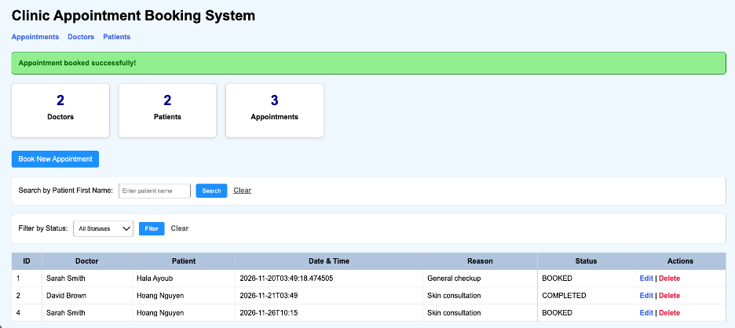
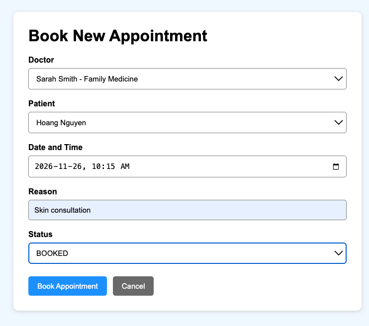
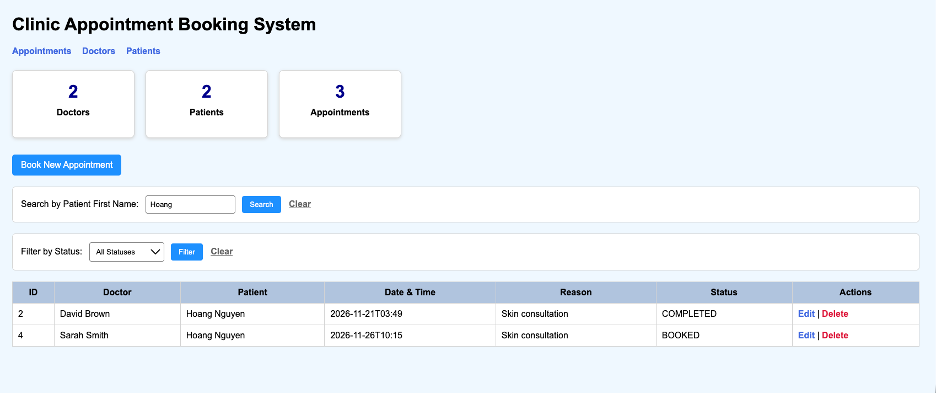
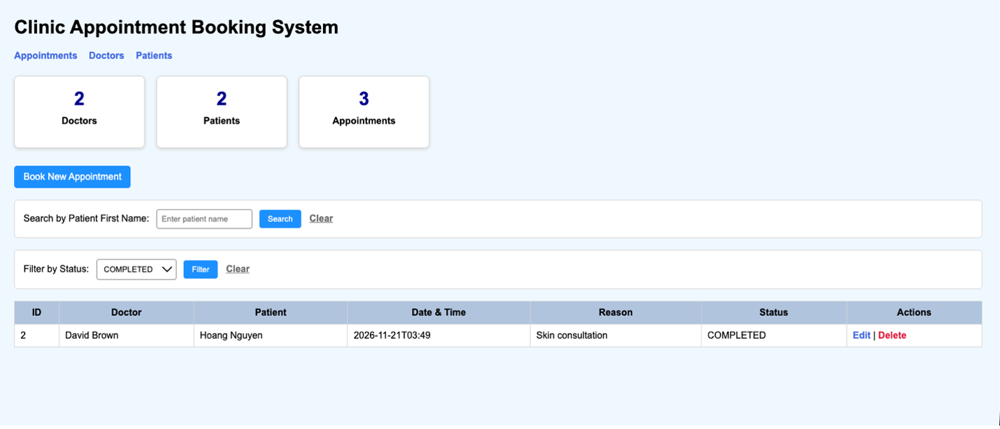

# Clinic Appointment Booking System

A web-based clinic appointment management system developed using Java and Spring Boot.

Developed by **Sama Aledan** as an academic project at Sheridan College.

The application manages appointments between doctors and patients through an interactive dashboard, appointment scheduling, search, filtering, and validation.

## Features

- Create, view, update, and delete appointments (CRUD)
- Dashboard displaying total doctors, patients, and appointments
- Search appointments by patient first name
- Filter appointments by status (BOOKED, COMPLETED, CANCELLED)
- Prevent booking appointments with past dates
- Display doctor and patient information
- Confirmation before deleting appointments
- Success messages for appointment operations
- Store and retrieve data using an H2 database

## Technologies Used

- Java 25
- Spring Boot 4.1.0
- Spring Data JPA
- Thymeleaf
- H2 Database
- Maven
- Lombok
- HTML
- CSS

## Screenshots

### 1. Dashboard

Displays appointment records and summary cards showing the total number of doctors, patients, and appointments.



### 2. Book New Appointment

Allows users to select a doctor, patient, date and time, appointment reason, and booking status.



### 3. Successful Booking

Displays a success message and updates the appointment count after a new appointment is created.


### 4. Search Appointments

Allows users to search appointments using a patient's first name.



### 5. Filter by Status

Allows users to filter appointments by BOOKED, COMPLETED, or CANCELLED status.



## How to Run the Project

### Requirements

- Java 25
- Internet access for downloading Maven dependencies on the first run

### Step 1: Download the Project

Download the repository ZIP file or clone the repository from GitHub.

### Step 2: Open the Project

Open the project folder in your terminal or preferred Java IDE.

### Step 3: Run Spring Boot

On macOS or Linux:

```bash
bash ./mvnw spring-boot:run
```

On Windows:

```cmd
mvnw.cmd spring-boot:run
```

### Step 4: Open the Application

Once Spring Boot starts, visit:

http://localhost:8080/

## Running Tests

Run the following command:

```bash
bash ./mvnw test
```

The existing automated test completed successfully during local testing.

The application was also manually tested, including:

- Dashboard functionality
- Create appointment
- Update appointment
- Delete appointment
- Search appointments
- Filter by status
- Date validation
- Doctors page
- Patients page

## Database

The application uses an in-memory H2 database.

### Database Entities

- Doctor
- Patient
- Appointment

Each appointment is associated with a doctor and a patient.

Sample records are initialized when the application starts.

Because the database is in-memory, changes are not preserved after the application stops.

### H2 Console

http://localhost:8080/h2-console

Connection details:

- JDBC URL: jdbc:h2:mem:clinicdb
- Username: sa
- Password: Leave empty

## Project Structure

- `src/main/java` - Java application source code
- `controllers` - Handles web requests and appointment operations
- `beans` - Entity classes and appointment status definitions
- `repositories` - Database access using Spring Data JPA
- `bootstrap` - Initializes sample application data
- `src/main/resources/templates` - Thymeleaf HTML pages
- `application.properties` - Application and database configuration
- `screenshots` - Application screenshots

## Future Improvements

Potential improvements include:

- User authentication and role-based access
- Email appointment notifications
- Improved responsive design
- A persistent production database
- Enhanced appointment scheduling and validation

These improvements are planned possibilities and are not part of the current implementation.

## Developer

**Sama Aledan**

Computer Systems Technology – Software Development and Network Engineering

Sheridan College

## Project Information

- **Type:** Academic Project
- **Course:** Advanced Java Frameworks
- **Institution:** Sheridan College
- **Status:** Completed and Tested

## Project Status

The application was successfully started and manually tested on macOS using Java 25 and Spring Boot.

The existing Maven automated test also completed successfully.
